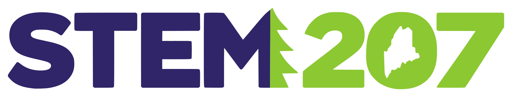

<p></p>

# STEM 207

**Live site:** https://mattjones1.github.io/stem_207/

**Maine's STEM explorer for grades 2–8.** Teachers and students choose a category, find an activity that fits their time and equipment, read it, and launch it. The content is rooted in Maine: lobster boats and tide pools, the North Woods and Katahdin, sugarhouses, nor'easters, and fall fairs.

**Choose a category → Select an activity → Do it → Send what you learned for a check.**

## What's included

- **Activities** (`#/activities`) in seven categories: Coding & Computer Science, Virtual Reality, Artificial Intelligence, Engineering & Robotics, Science & Discovery, Creative STEM, and **3D Printing (coming soon)**. Each category lists its activities with filters for topic, level, grade band, time, and equipment, plus search. Students, educators, and guests share this view.
- **Activity pages** with Your mission, What you'll learn, Before you begin, Your steps, Launch activity, and Teacher notes, plus the **Show what you know** reflection students send for a check. VR activities also include setup notes and a way to take part without a headset.
- **Learning Plans**: an educator puts activities in order and assigns the plan to a whole class. Five templates are ready to copy, including **Coding Foundations** (the seven-stage coding pathway) and the **AI Learning Route**.
- **One check for every activity**: the student sends a reflection, and the teacher marks **Pass** or **Try again**. XP comes only from a Pass.
- **Interactive labs** that run inside the site (see below).

**Names used everywhere:** an **Activity** is one thing a student does. A **Learning Plan** is an ordered set of activities for a class. A **Class** is a roster with a sign-in code. A **Category** is one of the seven areas.

## Ready-to-teach activities (outside tools)

Some activities run on outside platforms. Their full teaching packs are Markdown files in `missions/`:

- **Teach the Computer Your Secret Signals** (AI, grades 2–8, Google Teachable Machine): [`missions/ai/secret-signals/`](missions/ai/secret-signals/). Includes a student version, a low-reading version, a teacher guide, a before-and-after test table, and hints with an extension.

## Classroom pilot

Six activities are marked as the pilot set (teachers can filter for them): Robot Dance Party, Robot Maze, Click Tap Go! Event Party, Feed the Space Blob, How Does an AI Sort?, and Pattern Predictors. Each lists student core time and teacher prep separately (pilot estimates until timed in a classroom), a "You're done when" stopping point, a "Show what you know" check that students can say, show, or write, student-visible "Stuck?" hints, and a next step. Rehearsal and observation sheets are in [`pilot/`](pilot/).

**Teaching the why.** Every lab level opens with "What you'll learn" and "Why it matters," and the level-complete panel repeats why it matters. The coding activities add a "Why it matters" section with a real-world connection and key words. Pattern Machine Lab explains Glims and Norps (Level 3) and teaches confidence scores and thresholds with a diagram (Level 5). Level 6 has 10 cases: students score their decisions, 7 of 10 passes, and passing earns a printable STEM 207 certificate ("Responsible AI Explorer") with their display name and class. Bug Hunt shows students the robot chef's buggy algorithm and gives teachers a robot chef script.

**Grades 6–8 coding track.** Every coding stage has an activity written for grades 6–8, and suggestions for 6–8 students pick it first: Sort the Catch (compare two sorting algorithms by counting comparisons), Lighthouse Network (broadcast messages), Snowstorm Simulator (clones and repeat until), Nor'easter Alert Station (and/or/not with a test table), Catch Log (lists, totals, averages), Snowflake Studio (custom blocks with several inputs that use each other), and Capstone Studio (design doc, two playtests, release notes). From Blocks to Python rewrites a Scratch custom block as a Python function with turtle drawing in the Raspberry Pi Foundation's free Code Editor. Loop Dance Choreographers finishes in Scratch with a Dance Crew starter (the 16-move dance written out long, to shorten with loops).

**Learning routes.** Scratch activities that build on a lab say so ("You've seen this idea before") and link back to it. Debug the Broken Animation and Pattern Studio with My Blocks have downloadable starter projects (`assets/starters/`, rebuilt with `tools/build_starters.py`), and Score Keeper shows a picture of where its blocks go.

## Checks: one way for every activity

1. The student does the activity and sends a reflection from **Show what you know**: written, or "I'll show or tell my teacher".
2. The teacher opens **Checks** (`#/teach/checks`, with a count in the top menu), or a Learning Plan's Checks tab.
3. The teacher marks **Pass** (how they checked: the student said it, showed it, or the teacher reviewed the work) or **Try again** (a note is required).
4. A Pass earns the student's XP. A Try again reopens the activity at the top of the student's Home, with the note.

Each activity shows one status per student, in words: *Not started*, *In progress*, *Sent*, *Passed*, or *Try again*. XP is recalculated from the activity log, so past work counts only once it's passed. Sending, lab levels, and repeats earn no XP. The same "How checks work" guide is open on Checks and folded on every activity page.

## Learning Plans

A **Learning Plan** is an ordered set of activities from any category, assigned to a whole class. Educators find them under **Learning Plans** (`#/teach/plans`), with a **Current / Finished** toggle, drafts, and templates.

- **Build your own, à la carte.** Pick activities from any category: category tabs list every activity in that category (3D Printing shows as coming soon), with grade and time filters and a search across every category. "Your mix" shows how many activities come from each category, for example one Coding, one Virtual Reality, and one AI.
- **Or start from a template** (`assets/js/data/templates.js`). "Use this template" makes the educator's own copy; the template never changes.
  - **STEM 207 workshops** (proposed, review before teaching), each with a workshop format, sessions, and content that's coming later:
    - **Maine Tech Sampler**: grades 4–5, a half day, one activity from each category.
    - **Robots & Smart Machines**: grades 4–8, two 90-minute sessions, from rules to learning machines. Moxie comes later.
    - **Coast to Katahdin Explorers**: grades 2–5, four 45-minute sessions. 3D Printing comes later.
  - **Classroom templates:** Maine Coast Explorers, How Machines Make Decisions, From Instructions to Invention, AI Learning Route (proposed), and Coding Foundations (the seven coding stages).
- **Edit** the title, goal, grades, and the activities. Each activity is required or optional and can have a note to students. Reorder with Move up and Move down (keyboard) or by dragging. Changes save automatically.
- **At a glance**: student time (optional activities listed separately), teacher prep or "not recorded", categories, equipment, and advice on grade fit, accounts, cost, supervision, full labs, multi-session activities, and coding-stage order.
- **Assign to a class.** Every student in the class sees it. A required activity must be published and have a resource; one with no resource can only be optional.
- **Update for students** appears after you edit an assigned plan, and sends the changes to every class that has it. Underneath, each class stays on the version it was given until you update.
- **The plan page** has three tabs: **Activities**, **Students** (each student's status on each activity, and how many required activities they've passed), and **Checks** (this plan's waiting reflections, with Pass and Try again right there).
- **Duplicate** a plan, or **Finish** it when the class is done. Finished plans move to the Finished list, and students see them under All.
- **Add to a Learning Plan** is on every activity page for educators: pick a plan, or start a new one with that activity.
- **Old single assignments.** A class that still has activities assigned one at a time gets a banner on Learning Plans that moves them into one plan.
- In cloud mode, plans need `supabase/update-6-pathways.sql` (each educator sees only their own, and given versions can't be edited) and `supabase/update-10-plan-status.sql` (students can tell current plans from finished ones).

## Moxie: a physical computing pathway (draft)

**Moxie: Code it. Build it. Make it matter.** Moxie is 16 ESP32 sessions in four units: Outputs; Inputs & Decisions; Displays, Time, Sensors & Motion; and a Capstone where partners build a device that helps someone. It belongs to Engineering & Robotics.

**What's built:**
- `#/moxie`: the overview, with the unit map, final-project requirements, kit, and how partners work.
- A session page for each of the 16 sessions. Build sessions have these parts: Your mission, Before you wire, Build it, Plan it, Code it, Test it, Explain it, and Stretch.
- Capstone tools:
  - Session 13: a design worksheet that checks for one input, two different output types, and three measurable criteria.
  - Session 14: a build log and code checklist.
  - Session 15: test results, feedback, an improvement, and a showcase card.
  - Session 16: a final checklist and a private reflection with self-ratings.
- `#/moxie/teach` for educators: preparation, assigning, partner teams, teacher checks, and rubric feedback.
  - Teacher checks: wiring in 11, plan in 8, design in 13, and pitch in 16.
  - Rubric feedback is written per dimension, with no scores.

**How partners work.** Partners share one design, build log, and test results. Each student's plan, explanation, and reflection stay their own.

**Content versions.** Work saved against an older content version is labeled with that version.

**This is the outline edition.** Every session is a draft that only educators can see. Grades and time per session say "pending". The lesson text, wiring, and code stay out of this public repo until reuse permissions are confirmed. Answer keys never go here.

**More detail:**
- The brief: [`planning/MOXIE_PLAN.md`](planning/MOXIE_PLAN.md)
- What's reused and what was added: [`planning/MOXIE_AUDIT.md`](planning/MOXIE_AUDIT.md)
- What to test before a pilot: [`planning/MOXIE_VALIDATION.md`](planning/MOXIE_VALIDATION.md)

Partner teams in cloud mode need [`supabase/update-5-moxie-teams.sql`](supabase/update-5-moxie-teams.sql).

## Interactive labs

Each exploration area has its own leveled, interactive lab that runs inside STEM 207, with no outside account or website. Every level teaches one idea, gives a hint on request, checks the student's work, and ends with "What you just learned." Lab work counts toward lab patches and the weekly streak; XP comes when the teacher passes the lab activity.

| Area | Lab | Levels | What students learn |
| --- | --- | --- | --- |
| Coding & Computer Science | **Harbor Code Lab** | 36 | Three voyages of 12 levels (Casco Bay, Penobscot Bay, Down East). Steer a lobster boat: haul and set traps, dodge granite ledges, find the mooring in fog. Sequences, debugging with step-through, loops, actions, conditionals (if / if–else), a variable, functions (custom blocks), free build. Levels map to coding pathway stages. |
| Coding & Computer Science | **Robot Dance Party** | 4 | A 10-minute first coding lesson for grades 2–8. Build a dance from five moves (Move left, Move right, Jump, Spin, Strike a pose), reorder or remove steps with buttons, and run it with each step highlighted. Predict first and last, swap two steps, make a 5+ step dance, then the challenge: jump, spin, and finish with a pose, checked from the steps the robot actually ran. Two hints per level. |
| Coding & Computer Science | **Feed the Space Blob** | 4 | A 15-minute variables lesson for students who know sequences and click events. Two editable code stacks (`when run starts: set snacks to [0]`, `when Feed is clicked: change snacks by [1]`) drive a live “snacks” monitor. Feed and count, change the amount and predict, switch off the reset block to see why programs need a starting value, then the challenge: start at 2, add 3, reach 14 after 4 feeds. The challenge checks the start value, amount, and feed count, not just the total. |
| Coding & Computer Science | **Moon Base Gatekeeper** | 5 | Conditionals for students who know events and stored values. Edit `IF visitor badge equals [Moon/Star/Planet] THEN [Open gate/Keep gate closed] ELSE [...]`, predict, and test robot visitors. Every test shows a step-by-step trace (the comparison, the branch taken, the branch skipped) and goes in a test log. Find the bug in a rule where both branches open the gate, then the Star-team challenge, which only passes when all three badges are tested on the current rule (edits invalidate earlier results). |
| Coding & Computer Science | **Robot Chef** | 5 | The on-screen version of Bug Hunt: Fix the Sandwich Algorithm (grades 2–5, Stage 1). A robot chef follows a sandwich algorithm literally and stops at the first bug, naming the student's own step and what it needed. Find and name the first bug, fix the order with Up and Down, add missing steps from a bank, rewrite unclear steps (one vague step becomes several precise ones), then write the whole algorithm from a bank that includes unclear steps. Buttons only, no dragging. |
| Virtual Reality | **Field Station 360** | 7 | Look-around Gulf of Maine tide pools and a North Woods pond below Katahdin, then a rainforest, desert, and coral reef, with compass headings. Observation vs. inference, adaptations, comparing five habitats. A 360° look-around page (drag, tap, or arrow keys), not an immersive headset experience. |
| Artificial Intelligence | **Pattern Machine Lab** | 6 | Find a pattern, train a real k-nearest-neighbors classifier, see accuracy grow with more examples, uncover biased data, set a confidence threshold, judge responsible uses (including counting puffins and sorting wild blueberries). Made-up creatures only. |
| Engineering & Robotics | **Pumpkin Launcher Lab** | 6 | Design–test–iterate a catapult for a fall-fair pumpkin toss: prediction, one-change-at-a-time fair tests, a hay-bale constraint, a budget, an engineering notebook. |
| Engineering & Robotics | **Snowplow Robot Lab** | 4 | After a nor'easter, sense → think → act rules for a two-sensor robot plow: debugging behavior, recovering at sharp corners, speed vs. accuracy. |
| Science & Discovery | **Sled Hill Science** | 5 | A model sledding hill: predict and test, natural variation and averages, controlling variables (powder, packed snow, ice), the "does weight matter?" misconception, claim–evidence–reasoning. |
| Creative STEM | **Pixel Animation Studio** | 6 | Pixels, resolution, run-length encoding (decode a lighthouse), frames and fps, and an original animation saved to the student's gallery. |

Each lab also has a library entry with a full teacher guide (mission, objectives, setup, steps, reflection, extension, and facilitation notes). Educators see lab progress per class and per student, including tests run, hints used, and saved animations.

Lab ids (`rover`, `launcher`, `line-follower`, `ramp-racers`) are kept from earlier versions so saved progress carries over. Lab code lives in `assets/js/labs/`. `lab-shell.js` provides the shared layout, hints, completion panel, and progress logging. Each lab registers itself with `SE.labs.register({ id, area, title, tagline, levels, chapters?, mount })` (optional `chapters` group levels into voyages, as in the Harbor Code Lab; a level can give `hints: [...]` instead of `hint` to reveal hints one at a time), so adding a lab means adding one file and one `<script>` tag.

## Accounts and progress (prototype)

**Students** sign in with a class code, by tapping their name, and by tapping three secret pictures from a login card their teacher hands out. They never type an email or password, and the only thing stored about them is a display name (first name and last initial) and a grade band.

**Educators** sign in with an email and password, create classes, add students, and print login cards.

**Try it with the sample class:**

| | |
| --- | --- |
| Educator | `demo@stem207.example` / `explore` |
| Student | class code `MOOSE7` → **Ava R.** → Pine tree, Lighthouse, Moon |

The sample class has eight made-up students with two and a half weeks of made-up activity, so the educator dashboard has something to show. It is labeled as sample data everywhere it appears, and **Reset sample data** on the dashboard restores it.

### What students get

Top menu: **Home · My Learning Plans · Activities · My harbor**.

- **Home** (`#/`) is one calm column:
  - a greeting with their rank;
  - one **Up next** card: a Try again first, then the next activity in a current Learning Plan, then an older single assignment, then their own work in progress or a suggestion. It has a big Start or Continue button and an **I need help** button that tells the teacher;
  - one line for what's waiting for the teacher;
  - the newest message from the teacher (older ones fold away), and a private note marked **Just for you** when the teacher sends one;
  - one line for the class journey;
  - two buttons: **My Learning Plans** and **Explore activities**.
- **My Learning Plans** (`#/plans`) with a **Current / All** toggle. Each plan shows its goal, "3 of 6 passed", and the next activity. A plan page (`#/plans/<id>`) lists its activities in order, each with its status, the teacher's note, and a Start, Continue, or Try again button.
- **Activities**: the same category view educators use. Activities students choose on their own use the same reflection and check.
- **Me** (`#/me`): rank ladder, the 18 patches, the class journey with class badges, saved creations, labs, and everything they've sent, with each status and the teacher's notes.
- **Ranks**: Deckhand → Tidepooler → Trail Scout → Lighthouse Keeper → Harbor Pilot → Ridge Runner → Katahdin Guide, each with a chevron insignia.
- **Two kinds of rewards.** *Personal:* XP, ranks, patches, and the harbor come from passes on any activity. *Class:* the **class journey** across Maine (Kittery, Portland Head, Penobscot Bay, Acadia, Moosehead, Katahdin) moves +100 each time the teacher passes class work (an assigned activity, or one in an assigned Learning Plan). The class also earns five **class badges** together. It's cooperative, so there's no leaderboard. On a student's device in cloud mode, the class totals come from `class_journey` (counts only, no names).
- **My harbor** (`#/base`): each student designs an illustrated explorer (skin tone, hair, hats, jackets, gear, background) and a home harbor that grows as they learn. Ranks and patches unlock 31 items: a lobster boat they name and paint at Tidepooler, a camp cabin, a lighthouse, a sailboat, puffins, a loon, a moose, the northern lights, and Katahdin.
- **No personal info in avatars**: avatars are drawings built from preset parts, and boat names are picked from two word lists, so students never type free text or upload photos. Choices are saved as `profile_custom` events in the activity log.

### What educators get

Top menu: **Dashboard · Learning Plans · Activities · Classes · Checks**.

- **Dashboard** (`#/teach`) across all classes: a greeting, checks waiting, your classes (each with Add students and Message), current Learning Plans with class progress, a **Recent activity** feed (sent, passed, try again, help, notes), a "needs a check-in" list with a **Note** button, and quick actions (New Learning Plan, Message a class, Add a class).
- **Quick tasks open in one shared dialog:** **Add students** (paste names one per line; each is checked for privacy and duplicates, then the new login cards are ready to print), **Message a class**, and **Send a note** to one student.
- **Learning Plans** (`#/teach/plans`): see above.
- **Activities** (`#/activities`): every activity by category, with **Add to a Learning Plan** on each activity page.
- **Classes** (`#/teach/classes`): a card per class with Add a class, and Archived classes with Restore. A class page has rename, archive, and delete (type the class name to confirm, since it removes the students and their work), the roster, Learning Plans, the class journey, labs, **messages** to the class, adding students, sign-in steps, printable login cards, and a live activity log.
- **Checks** (`#/teach/checks`): one queue of every sent reflection across classes, with Pass and Try again, and "Show what you checked in the last 2 weeks".
- **Student detail**: rank, XP, patches, every activity with its status and reflections, a full activity timeline, and **Send a note**.

### What gets recorded

Each student action is saved as an event: signed in, opened an activity, checked a step, launched a resource, sent a reflection (`mission_completed`, with the answer and confidence), asked for help. Teacher actions are also events: passed (`teacher_confirmed`), try again (`teacher_try_again`), or a private note (`teacher_note`). XP, ranks, and patches are calculated from the events using the rules in `assets/js/data/progression.js`, so changing a rule updates everyone.

## Back end (Supabase, free)

STEM 207 runs in one of two modes, chosen by `assets/js/config.js`:

| | Local mode (default) | Cloud mode |
| --- | --- | --- |
| Turn on by | Leaving `config.js` empty | Pasting a Supabase URL and publishable key into `config.js` |
| Where data lives | This browser only | Your Supabase Postgres database, shared across every device |
| Educator passwords | Hashed in the browser | Handled by Supabase Auth |
| Student sign-in | Checked in the browser | Checked by the database; 8 wrong tries in 10 minutes pauses sign-in |
| Sample class | Built in (`demo@stem207.example`) | Any educator can add one from **Class & logins** |
| Works offline | Always | Keeps working; changes save when the connection returns |

### Set up the free back end (about 10 minutes)

1. Create a free account at [supabase.com](https://supabase.com) and click **New project**. Pick a region near Maine (for example US East) and save the database password somewhere safe.
2. In the project, open **SQL Editor → New query**, paste all of [`supabase/schema.sql`](supabase/schema.sql), and click **Run**. (Already set up before? Run the updates you haven't run yet, in order: [`supabase/update-2-assignments.sql`](supabase/update-2-assignments.sql) for assigned missions, then [`supabase/update-3-class-messages.sql`](supabase/update-3-class-messages.sql) for class messages and assignment instructions, then [`supabase/update-4-class-journey.sql`](supabase/update-4-class-journey.sql) so students see the whole class's journey, then [`supabase/update-5-moxie-teams.sql`](supabase/update-5-moxie-teams.sql) for Moxie partner teams, then [`supabase/update-6-pathways.sql`](supabase/update-6-pathways.sql) for educator pathways, then [`supabase/update-7-pathway-teams.sql`](supabase/update-7-pathway-teams.sql) so partners share pathway team artifacts, then [`supabase/update-8-class-journey-passes.sql`](supabase/update-8-class-journey-passes.sql) so class points come from teacher passes, then [`supabase/update-9-classes.sql`](supabase/update-9-classes.sql) to archive classes, then [`supabase/update-10-plan-status.sql`](supabase/update-10-plan-status.sql) so students can tell current Learning Plans from finished ones.) It creates the tables, the security rules, and the student sign-in functions. Running it again is safe.
3. Open **Authentication → Sign In / Providers → Email** and turn off **Confirm email** while you're prototyping, so new educator accounts work right away. (If you leave it on, teachers must click the link in a confirmation email first. In that case, set **Authentication → URL Configuration → Site URL** to wherever your site lives.)
4. Open **Project Settings → API Keys**. Copy the **Project URL** and the **publishable** key (older projects call it the **anon public** key) into `assets/js/config.js`. Never use a secret or `service_role` key here.
5. Commit and push. GitHub Pages serves the site with the back end on. To make the one-file version use it too, run `python tools/build_single_file.py` again.
6. Open the site, choose **I'm an educator → Create an educator account**, then add students or **Add a sample class** to explore the dashboard with made-up data.

Free projects pause after about a week with no activity. If that happens, open the project in the Supabase dashboard and click **Restore**.

### How it works

- `supabase/schema.sql` defines five tables (`educators`, `classes`, `students`, `events`, plus private `student_sessions` and `sign_in_attempts`) with row-level security. Each educator can read and change only their own classes, students, and events.
- Students never get a Supabase account. They sign in through database functions (`class_roster`, `student_sign_in`, `student_state`, `student_log`, `student_sign_out`) that check the picture code on the server and hand back a 7-day session token. Picture codes are visible only to the student's educator.
- `assets/js/cloud.js` is a small client for Supabase Auth, REST, and RPC with no extra libraries, so the app still runs as plain files.
- `assets/js/store.js` keeps the same `SE.store` API in both modes. In cloud mode it loads the signed-in person's data once, serves every screen from memory, and sends each change to the server in order in the background, retrying if the connection drops.
- `tests/backend/` has a Supabase stand-in for testing the rules and sync on plain Postgres. See its README.

### Before using with real students

1. Review student-data requirements (COPPA, FERPA, Maine student privacy law, and district policy) and get the approvals your program needs. Supabase's free tier is meant for prototypes; a district rollout should use a paid plan with a data processing agreement.
2. Keep collecting only display names and grade bands for students.
3. Keep **Confirm email** on once real educators are signing up.

## Made in Maine

Eight original activities are rooted in Maine, alongside the five Maine-themed labs:

| Activity | Area | What students do |
| --- | --- | --- |
| Lobster Trap Logic | Coding | Write if–else rules for Maine's lobster size, egg, and V-notch rules (featured mission) |
| Acadia from Above | Virtual Reality | Fly over Acadia in Google Earth and read glacier clues |
| Blueberry Sorting Machine | AI | Train a human "machine" to sort wild blueberries, then catch it missing examples |
| Lighthouse Beam Challenge | Engineering | Build a foil reflector that focuses a flashlight beam |
| Float a Wind Turbine | Engineering | Keep a model floating turbine upright in waves, like UMaine's VolturnUS |
| Tide Watchers: Portland vs. Eastport | Science | Graph a day of tides at two harbors and explain the difference |
| Sap Run Detectives | Science | Find the freeze–thaw pattern in sugarhouse data and do the 40-to-1 syrup math |
| Animated Maine Postcard | Creative | Animate a favorite Maine place in Scratch |

## Running it

- **One-file version:** run `python tools/build_single_file.py` to create `dist/STEM 207.html`. Double-click that file to run the whole app offline, with no server needed. You can copy it to any computer.

It's a static site with no build step and no dependencies.

- **Open locally:** double-click `index.html`, or run `python3 -m http.server` in this folder and visit `http://localhost:8000`.
- **Publish with GitHub Pages:** in the repo, go to **Settings → Pages**, set the source to **Deploy from a branch**, and pick `main` and `/ (root)`.

## Project layout

```
index.html                    Page shell: header, footer, script tags
assets/css/styles.css         All styles. Color and type tokens are at the top.
assets/js/data/areas.js       Exploration areas, levels, grade bands, durations, formats, equipment
assets/js/data/activities.js  The activity library
assets/js/data/pathway.js     The seven coding stages and the AI route (data for two templates)
assets/js/data/templates.js   Learning Plan templates
assets/js/data/moxie.js       The Moxie pathway: units, kit, capstone, and the 16 session records
assets/js/data/drafts-3d-printing.js  The five 3D Printing placeholders (drafts)
assets/js/data/imported.js    Missions added with tools/import_missions.js (generated)
assets/js/data/progression.js XP rules, ranks, patches, class goal, picture codes
assets/js/core.js             Shared helpers and icons
assets/js/content.js          Content status: published or draft, version, readiness, who can see or assign it
assets/js/config.js           Back-end settings: empty = local mode, Supabase URL + key = cloud mode
assets/js/cloud.js            Small Supabase client (Auth, REST, RPC)
assets/js/store.js            Accounts, sessions, activity log, sample class, cloud sync
supabase/schema.sql           Database tables, security rules, and student sign-in functions
tests/backend/                Supabase stand-in for testing cloud mode on plain Postgres
assets/js/game.js             Turns the activity log into statuses, XP, rank, patches, and the class journey
assets/js/art.js              Insignia, patches, star map, class goal track
assets/js/base.js             Student avatars, the "My harbor" scene, and gear/harbor unlocks
assets/js/views-*.js          Activities, student (Home, Me), sign-in, educator, Learning Plans, and Moxie views
assets/js/main.js             Router and header
```

## Adding an activity

Copy any entry in `assets/js/data/activities.js`, give it a new `id`, and fill in the fields. The new activity appears in the library, its area page, and search automatically.

| Field | Notes |
| --- | --- |
| `id` | Unique, lowercase, hyphenated. Used in the URL: `#/activity/<id>` |
| `title`, `summary` | The summary is one student-friendly sentence for the card |
| `area` | One of `coding`, `vr`, `ai`, `engineering`, `science`, `creative`, `3d-printing` (coming soon) |
| `level` | `beginner`, `intermediate`, or `advanced` |
| `grades` | Any of `"2-3"`, `"4-5"`, `"6-8"` |
| `duration` | Minutes. Used by the 20/30/45 time filter |
| `format` | `independent`, `collaborative`, or `teacher-led` |
| `equipment` | Keys from `equipment` in `areas.js` (for example, `computer`, `unplugged`, `vr`) |
| `source` | `"original"` shows the "Original STEM 207 lesson" label |
| `keywords` containing `"maine"` | Shows the **Made in Maine** tag and adds the activity to the dashboard's Made in Maine rail |
| `featured` | `true` on one activity makes it the featured classroom mission |
| `pathwayStage` | Optional. Links a coding activity to a pathway stage (1–7) |
| `keywords` | Extra words for search |
| `access` | `account` (`none`, `optional`, `required`), optional `accountNote`, `cost` (`free`, `paid`), `supervision` (true/false), `hardware` (list of strings) |
| `launch` | See below |
| `mission`, `learn`, `before`, `steps`, `reflect`, `extend`, `teacherNotes` | Activity page content. `before` has `materials`, `setup`, `prerequisites` |
| `vr` | VR only: `setup` (teacher notes) and `nonHeadset` (how to take part without a headset) |
| `pub`, `version` | Optional. Leave both off for a normal published mission (version 1). `pub` is `draft`, `review`, `hardware`, `pilot`, or `published`. Unpublished records go in `STEM.drafts`: only educators see them, and they aren't listed, counted, suggested, or assigned (pilot records can be assigned) |
| `alsoIn` | Optional. Other areas where the mission also fits. It's listed under "Also fits here" there, but counted once, in its own area |
| `skills` | Optional. Ids from `STEM.skills` in `areas.js` |
| `delivery` | Optional. How it's actually delivered when that differs from the area, for example "Browser 360° (not headset VR)". Shown as a chip and in the facts |

### Importing missions

To add missions from another source without editing `activities.js`, put them in a JSON file (an array, or `{ "missions": [...] }`) and use the import tool:

```
node tools/import_missions.js missions.json                 # dry run: check and report, save nothing
node tools/import_missions.js missions.json --write         # save the accepted missions
node tools/import_missions.js missions.json --write --new-version   # also allow changes to a published import
```

- Records use the fields above. Accepted ones are saved to `assets/js/data/imported.js` (generated; don't edit by hand) and appear in the library with no new page code.
- A published mission needs every field the mission page shows. A draft (`"pub": "draft"`) needs only `id`, `title`, and `area`. Labs can't be imported, because they need code.
- The tool rejects:
  - a badly formed id, or the same id twice in one file;
  - an id that belongs to a hand-written record;
  - a title another record already uses;
  - an unknown area, skill, or equipment key;
  - a launch link that isn't https.
- A published import is never overwritten silently. Changing one needs `--new-version`, which bumps its version.
- Text is cleaned (HTML tags and control characters are removed). Attribution in `source` is kept.
- Tests: `node tests/tools/test_import_missions.js` (fixtures in `tests/fixtures/import/`).

### Launch links

- `{ status: "ready", label, url, provider, note }` shows a **Launch activity** button that opens in a new tab.
- `{ status: "coming-soon", note }` shows **Resource coming soon**. Use this until a resource has been chosen and checked. Don't add placeholder links.
- `{ status: "none" }` marks a hands-on activity whose full directions are on the page.

Check every external link before adding it, and record whether it needs an account, costs money, or needs special hardware.

## External resources in this version

| Resource | Used by | Notes |
| --- | --- | --- |
| [Blockly Games: Maze](https://blockly.games/maze) | Robot Maze | Free, no account |
| [Scratch editor](https://scratch.mit.edu/projects/editor/) | Several coding and creative activities | Free; an account is needed only to save online |
| [Teachable Machine](https://teachablemachine.withgoogle.com/) | Train a Classroom Model | Free; teacher-run on a single computer |
| [Code.org AI for Oceans](https://code.org/oceans) | Clean the Ocean with AI | Free; sign-in is optional |
| [Google Earth](https://earth.google.com/web/) | Explore a Virtual Ecosystem | Free; works best in Chrome |

Two activities are marked **Resource coming soon** until the program picks a resource: the 360° Notice & Wonder Challenge (needs a 360° scene) and Stop-Motion Story Studio (needs a stop-motion app). The ecosystem field trip uses Google Earth now and still needs a headset experience.

## Brand

STEM 207, LLC is a program offered exclusively through **STEM Coliseum and Learning Center**, its parent company, and the site is co-branded. A white brand row at the top of every page shows the STEM 207 logo "powered by" a large STEM Coliseum logo, which links to the [STEM Coliseum and Learning Center website](https://stem-coliseum.odoo.com/). The footer carries the STEM Coliseum and Learning Center logo and the relationship, and the sign-in card and printable certificates show the parent logo too. The site uses STEM Coliseum's palette (Dark Teal `#012d2b`, Teal `#03968f`, Green 2 `#94c93d`) and fonts (Montserrat headings, Open Sans body). The STEM 207 wordmark keeps its drawing (the pine in the M, Maine in the 0), recolored to Dark Teal and Green 2. Rules for both brands are in [`brand/BRAND.md`](brand/BRAND.md); the parent brand guide and logo files are in [`brand/coliseum/`](brand/coliseum/). The STEM 207 mission is **Keep the humanity in technology.**

## Accessibility

Keyboard navigation with visible focus, a skip link, focus moved to the page heading on each view, touch targets of at least 44px, and experience levels shown with filled squares and a text label so meaning never relies on color alone. The site follows the device's light or dark setting.
